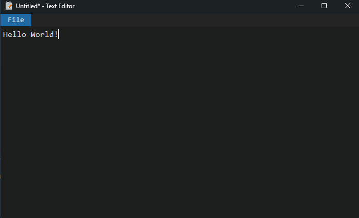

# Python Text Editor

A lightweight, simple, and modern desktop text editor built with Python and CustomTkinter.

<p align="center">
  
</p>

<p align="center">
  
  
  
</p>

## Features

- Simple UI
- Create and edit text documents
- Lightweight standalone Windows executable

## Download

Download the latest version from the [Releases](../../releases) page.

### Windows

1. Download the latest `PythonTextEditor-Windows-x64.zip`.
2. Extract the downloaded ZIP archive.
3. Open the extracted folder.
4. Run `Text Editor.exe`.

**Note:** Python does not need to be installed to run the prebuilt executable.

## Running from Source

Clone the repository:

```bash
git clone https://github.com/mooncreations/text-editor.git
```

Navigate to the project directory:

```bash
cd text-editor
```

Install Custom Tkinter:

```bash
pip install customtkinter
```

Run the main file:

```bash
python app.py
```

## Building from Source

This project uses [PyInstaller](https://pyinstaller.org/) to package the application into a standalone executable.

Install PyInstaller:

```bash
pip install pyinstaller
```

Build the application using the .spec file:

```bash
pyinstaller "Text Editor.spec"
```

The compiled application will be available in the `dist/` directory.

## Technologies

- [Python](https://www.python.org/)
- [CustomTkinter](https://customtkinter.tomschimansky.com/)
- [PyInstaller](https://pyinstaller.org/)

## Project Structure

```text
text-editor/
├── docs/
│   └── images/
│       └── demo.png
├── app.py
├── icon.ico
├── Text Editor.spec
├── README.md
└── LICENSE
```

## Contributing

Contributions, suggestions, and bug reports are welcome!

Feel free to open an issue or submit a pull request.

## License

This project is licensed under the GNU General Public License v3.0. See the [LICENSE](LICENSE) file for details.
